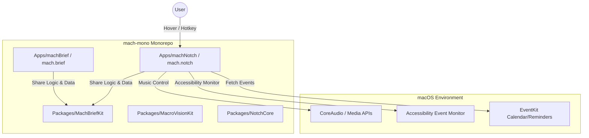
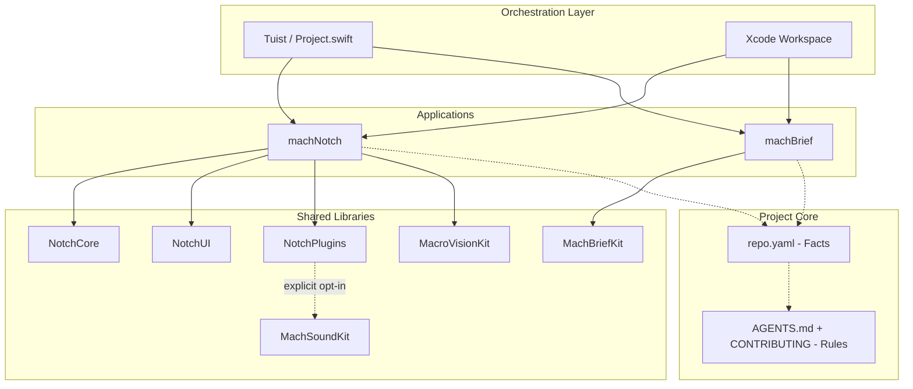
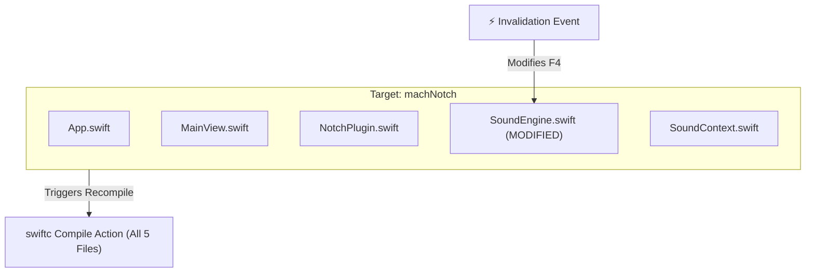
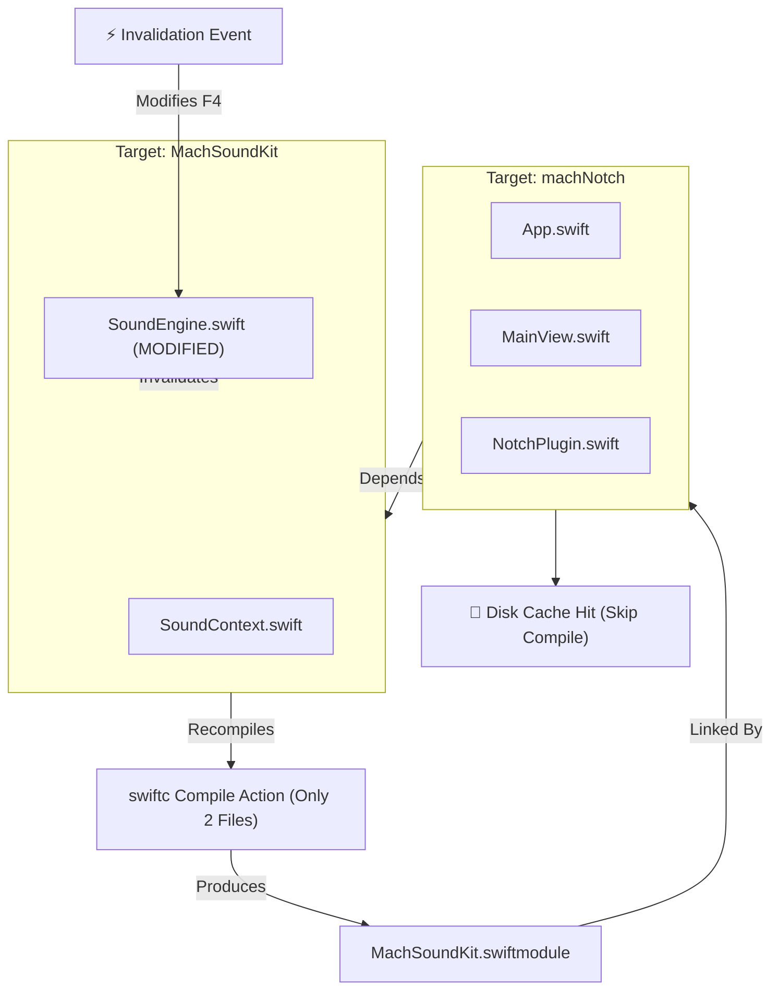

# machNotch System Architecture

This file is the single consolidated architecture reference for `machNotch` and the `mach-mono` repository.

---

## 1. System Overview

### High-Level System Context (C4 Level 1)

machNotch sits between the user, the macOS system, and local/external helper services.



### Container Diagram (C4 Level 2)

Inside the `mach-mono` repository, components are decoupled into small targets generated by Tuist and built with Xcode.



---

## 2. Plugin Architecture

A plugin-first architecture where every feature — including built-ins — is a conforming plugin.

### Build Boundary (2026-06-13, moved to Tuist 2026-08-30)

The plugin boundary is represented in the generated project:

- `NotchPluginCore` contains plugin protocols, `PluginManager`,
  `PluginContext`, settings wrappers, and plugin-facing UI environment helpers.
- Each built-in plugin is its own static framework target
  (`NotchMusicPlugin`, `NotchBatteryPlugin`, `NotchShelfPlugin`, etc.), produced
  by `Mach.notchPlugin(name:path:)` in `Tuist/ProjectDescriptionHelpers/Mach.swift`.
- `NotchPlugins` is the default facade used by machNotch. It re-exports the
  default built-ins and holds the app-facing view bridge helpers, but excludes
  Soundscape.
- `NotchPluginsWithSoundscape` is the explicit opt-in target for builds that
  include `NotchSoundscapePlugin` and therefore `Packages/MachSoundKit`.

Validation command:

```bash
task verify:no-soundscape
```

Bazel proved this with a graph query. The replacement inspects the built binary
with `nm` and `otool`, which is a stronger claim: it tests the artifact that
ships rather than the graph that produced it. CI runs the same check on the
Release build.

Note: `Packages/NotchPlugins/Package.swift` is a leftover SwiftPM shim and may
lag this target shape. `Packages/NotchPlugins/Project.swift` is canonical.

Runtime note: plugin registration is descriptor-based and strict on-demand.
Built-ins and discovered external plugins can be listed, ordered, and shown in
settings/API surfaces from metadata without constructing plugin instances.
Factories run only when a plugin is enabled, displayed, configured, exported, or
otherwise explicitly requested.

### Coexistence with third-party apps (2026-08-30)

A descriptor may declare that a third-party macOS app already covers its job:

```swift
PluginDescriptor(
    id: PluginID.shelf,
    ...
    coexistence: PluginCoexistence(
        app: KnownExternalApp.vorssaint,
        overlap: "a shelf for files, text and links",
        policy: .recommendDisable
    ),
    factory: { ShelfPlugin() }
)
```

The declaration sits on the descriptor, not the plugin, so settings can name the
overlap without constructing anything. That keeps the strict on-demand rule above
intact.

`ExternalAppDetecting` (NotchCore) resolves presence through
`NSRunningApplication` and `NSWorkspace.urlForApplication(withBundleIdentifier:)`.
Neither call prompts the user or needs an entitlement. Results are cached;
`PluginManager.refreshExternalApps()` clears the cache when a settings surface
appears.

`PluginManager` takes the detector by injection instead of reading it from
`services`. `summary(id:)` is a metadata-only path, so it must not need the full
service container, and test doubles must not have to grow a
`NotchServiceProvider` member.

Detection never changes plugin state. Both policies (`.inform`,
`.recommendDisable`) only render; the user makes the change. A user who
deliberately runs both apps must never find a plugin switched off behind their
back.

Detection is app-level. Vorssaint installs and uninstalls individual features,
but exposes no interface for that state, so machNotch cannot tell which of its
features are live.

Current declarations, all naming Vorssaint: `shelf`, `clipboard`, `webcam`,
`systemStats`. `battery` is deliberately excluded — Vorssaint puts battery health
in the menu bar, while `BatteryPlugin` is a closed-notch indicator, which is a
different surface rather than a duplicate.

### Launch cost and monitoring lifecycle (2026-08-30)

Plugins are constructed on demand, so services must be too. Two rules keep that
true, both covered by `Packages/NotchServices/Tests/NotchServicesTests/LaunchCostTests.swift`.

**Services are `lazy var`, never eager.** `ServiceContainer` stores its
dependencies and builds nothing. Each service is created on first access.
Constructing the container eagerly undid the plugin laziness one layer down: a
disabled plugin never asks for its services, yet all 30 were built at launch.
`lazy var` and not a computed property, because a computed property would hand
every caller its own instance, its own monitors and its own state.

**System monitors follow their observers, not the app lifetime.** A service that
installs event monitors or timers must not do it in `init`:

| Service | Was | Now |
| --- | --- | --- |
| `FaceService` | pointer monitor from launch; a `Timer` allocated per mouse-move event | reference-counted `startMonitoring()`, one repeating timer with `tolerance` |
| `DragDropService` | three global mouse monitors, started per notch window, never stopped | installed with the first observer, removed with the last |
| `ClipboardManager` | SQLite open plus a 50-row read on the main actor at launch | opened on first monitoring start |
| `MicrophoneMonitor` | `AVAudioRecorder` built in `init` | built on first `startMonitoring()` |

`DragDropService` keeps a list of observers, each with its own region and
handlers, because the single-callback version was overwritten by whichever notch
window initialised last — drag-to-shelf only worked on one display. Turning off
`shelfEnabled` removes those observers, which takes the monitors down with them.

SwiftUI views own their own timers through `.task`, which is cancelled on
disappear. A repeating `Timer` scheduled in `onAppear` and never stored can never
be invalidated, so every appearance leaves another one running for the life of
the app.

### Layer Diagram

```text
┌─────────────────────────────────────────────────────────────────────────────┐
│                              SwiftUI Views                                   │
│  ContentView, NotchHomeView, SettingsView                                   │
│  - No direct singleton access                                               │
│  - Receive PluginManager via @Environment                                   │
└─────────────────────────────────┬───────────────────────────────────────────┘
                                  │ renders
┌─────────────────────────────────▼───────────────────────────────────────────┐
│                            PluginManager                                     │
│  - Owns descriptor registrations and cached active plugins                  │
│  - Routes view requests to appropriate plugin                               │
│  - Manages plugin lifecycle (activate/deactivate)                           │
│  - Handles inter-plugin messaging                                           │
└─────────────────────────────────┬───────────────────────────────────────────┘
                                  │ manages
┌─────────────────────────────────▼───────────────────────────────────────────┐
│                         NotchPlugin Instances                                │
│  ┌───────────────┐  ┌───────────────┐  ┌───────────────┐  ┌──────────────┐ │
│  │  MusicPlugin  │  │ CalendarPlugin│  │  ShelfPlugin  │  │ WeatherPlugin│ │
│  │  :Playable    │  │  :Exportable  │  │  :Exportable  │  │              │ │
│  │  :Exportable  │  │               │  │  :DataStoring │  │              │ │
│  └───────┬───────┘  └───────┬───────┘  └───────┬───────┘  └──────┬───────┘ │
└──────────┼──────────────────┼──────────────────┼─────────────────┼──────────┘
           │ uses             │ uses             │ uses            │ uses
┌──────────▼──────────────────▼──────────────────▼─────────────────▼──────────┐
│                          Service Protocols                                   │
│  MusicService, CalendarService, ShelfService, WeatherService                │
│  - Wrap system APIs (MediaPlayer, EventKit, etc.)                           │
│  - Stateless or minimal state                                               │
│  - Injected into plugins via PluginContext                                  │
└─────────────────────────────────┬───────────────────────────────────────────┘
                                  │ accesses
┌─────────────────────────────────▼───────────────────────────────────────────┐
│                            Infrastructure                                    │
│  - System APIs (MediaPlayer, EventKit, CoreAudio, ScreenCaptureKit)         │
│  - Persistence (PluginSettings wrapping Defaults)                           │
│  - Networking (for Weather, future sync)                                    │
└─────────────────────────────────────────────────────────────────────────────┘
```

### Core Protocols

Every plugin must conform to `NotchPlugin`.

```swift
@MainActor
protocol NotchPlugin: Identifiable, Observable {
    var id: String { get }
    var metadata: PluginMetadata { get }
    var isEnabled: Bool { get set }
    var state: PluginState { get }

    func activate(context: PluginContext) async throws
    func deactivate() async

    @ViewBuilder func closedNotchContent() -> AnyView?
    @ViewBuilder func expandedPanelContent() -> AnyView?
    @ViewBuilder func settingsContent() -> AnyView?
}
```

---

## 3. Strict Modularization & Local Caching

We compile Swift targets through Xcode from Tuist-generated projects. To keep
incremental builds fast, we enforce **Strict Modularization**.

### Local Disk Cache

Build output goes to `.build/xcode` (see `Taskfile.yml`), outside the source
tree, so switching branches does not pollute the working copy.

- **Clear build output**: `task clean`

### Strict Modularization

Because any change inside a target invalidates that target's incremental build, we keep app modules small.

The machNotch app is one target (`machNotch`) plus an embedded XPC helper
(`MachNotchXPCHelper`) and a test target, declared in
[`Apps/machNotch/Project.swift`](Apps/machNotch/Project.swift). Reusable code
lives in the `Packages/` modules rather than in a second app-level module, so a
change inside one package invalidates only that package.

Bazel additionally split the app into `machNotch_Lib` and `machNotch_App` to
avoid compiling the app source set twice in clean builds. Tuist does not need
that split. The two diagrams below illustrate the principle, which the
package boundaries still carry.

#### Scenario A: Monolithic Target (Recompiles All Files on Single Change)



#### Scenario B: Modularized Targets (Recompiles Only Changed Target)



---

## 4. machSound Engine Specification v1 (Frozen)

This section maps out the exact DSP behavior of the Fluid Symphony sound engine, ported from WebAudio to `AVAudioEngine`.

### Master Chain

| Item | Value |
| --- | --- |
| Grid | 16th notes; `stepDur = spb/4`, `spb = 60/bpm` |
| Master gain | `volume²` (volume slider 0–1, default 0.65) |
| Compressor | Master dynamics: threshold −14 dB, ratio 4:1 |
| Reverb | Convolution; stereo impulse: 3.0 s white noise shaped by `(1 − i/len)^2.6` |
| Delay | Dotted 8th = `0.75·spb`, feedback 0.32, wet 0.5 |
| Sidechain | EDM kick ducks pads + bass to gain 0.22, linear recovery to 1.0 over 0.30 s |

### Synthesis Voices

- **kick**: Sine wave, frequency `fHi` exp→`fLo` over `dur·0.5`, gain exp→0.001 over `dur`.
- **noiseHit**: White noise through dynamic bandpass or highpass filter.
- **bass**: Sawtooth wave, lowpass filter 650 Hz exp→220 Hz over duration.
- **pad**: Detuned sawtooth waves (±7 cents), lowpass filter controlled by energy.
- **rhodes**: Mixed sine wave harmonics (`f` + `2f` at 0.28 gain), detuned ±4 cents.

### Performance Modes

- **EDM**: 126 BPM, C minor chords (`Cm`, `A♭`, `B♭`, `G`), 4-beat sidechain ducking.
- **Ambient**: 72 BPM, A minor scale, slow 2.0 s attack pads, sub swell, shimmer.
- **Lo-fi**: 78 BPM, C major 7th chords, swung steps (`s%4=2` delayed by `+0.14·spb`), vinyl pops.

---

## 5. Audio-to-Visual Splatting Contract

The visualizer responds to beat triggers and continuous amplitude (`audioLevel`) by drawing particles on a normalized coordinate space.

| Event | Coord (X, Y) | Target Splat Parameters |
| --- | --- | --- |
| **kick** | `0.5`, `0.42` | Radial burst of 5 splats, vel 260, k 0.16, radius 0.0035 |
| **note** | `0.18 + (midi%12)/11 * 0.64`, `0.5 ± 0.15` | Single splat, vel 210, k 0.30, radius 0.0011 |
| **bass** | `0.3 + rand * 0.4`, `0.16` | Vertical impulse, vel 240, k 0.18, radius 0.0022 |

Color palettes match the active music mode (e.g. ambient uses soft blue/cyan/orange, EDM uses purple/pink/magenta).

---

## 6. Inspirations

- [DockDoor](https://github.com/ejbills/DockDoor)
- [Atoll](https://github.com/Ebullioscopic/Atoll)
