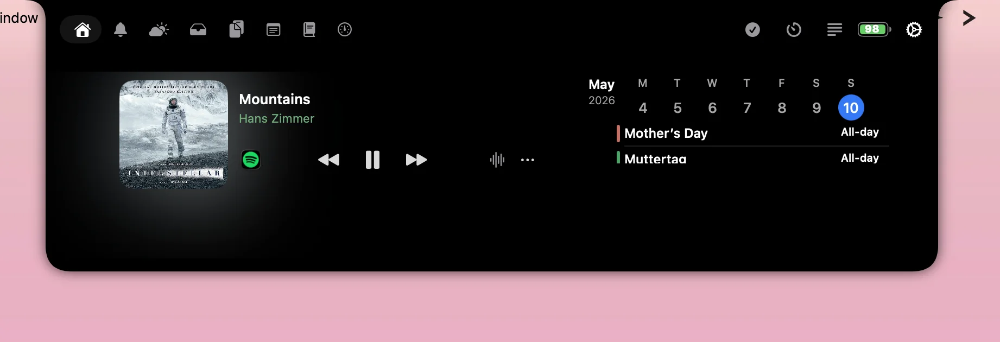
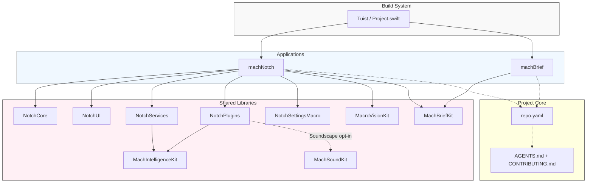

<h1 align="center">
  <br>
  <strong>mach-mono</strong>
  <br>
</h1>

<p align="center">
  A monorepo of focused macOS quality-of-life utilities — built on a hardened, plugin-first architecture.
</p>

<p align="center">
  <a href="https://github.com/larsboes/mach-mono/stargazers">
    
  </a>
  <a href="https://github.com/larsboes/mach-mono/actions/workflows/cicd.yml">
    
  </a>
  <a href="https://github.com/larsboes/mach-mono/blob/main/LICENSE">
    
  </a>
  
  
  
</p>

<p align="center">
  
</p>

---

## Design System

This monorepo adheres to a strict **Minimalistic Aesthetic**.

> **Core Principles:** Clarity, Cohesion, Tech-Forward, Subtlety.

---

## What is Mach?

**Mach** is named after the [Mach microkernel](https://en.wikipedia.org/wiki/Mach_(kernel)) — the foundational layer that powers macOS itself. The name reflects the goal: a solid architectural foundation that macOS utilities can be built on top of, fast and reliably.

`mach-mono` is a monorepo housing a growing suite of native Apple-platform utilities. Each app is a focused SwiftUI product sharing common architectural conventions and — where it earns its keep — shared Swift packages.

**Build system:** **[Tuist](https://tuist.dev)** generates the Xcode projects from `Project.swift` manifests. The `.xcodeproj` and `.xcworkspace` are build output and are gitignored — run `task gen`, then build from Xcode or from [Task](https://taskfile.dev).

See [`Roadmap.md`](Roadmap.md) for current priorities and [`Architecture.md`](Architecture.md) for architectural rationale. Historical ADRs, PRDs, and licensing-contract decisions are tracked as GitHub issues, not as in-repo markdown plans.

## Positioning

**mach.notch does not replace [Vorssaint](https://vorssaint.com). It builds around it.**

Four plugins cover jobs that Vorssaint also covers: shelf, clipboard, webcam and system stats.
Each of those descriptors declares the overlap. machNotch detects the installed app and
recommends in settings that you disable the plugin. Detection never changes plugin state by
itself, so a user who deliberately runs both apps keeps both. `battery` is excluded on purpose —
Vorssaint reports battery health in the menu bar, while `BatteryPlugin` is a closed-notch
indicator, which is a different surface. The mechanism and its limits are documented in
[Coexistence with third-party apps](Architecture.md#coexistence-with-third-party-apps-2026-08-30).

**Plugins are expected to retire.**

Many of these utilities exist because macOS does not ship the capability. When Apple ships an
equivalent natively, the matching plugin may be dropped instead of maintained in parallel. The
plugin architecture keeps that removal cheap: a plugin is one module behind one descriptor, so
it can leave without a change to the rest of the app.

## Background

This repo heavily relies on **Agentic Coding**. It grew organically out of curiosity for features and functionality, so code and architectural quality varies. Hardening reliability and improving code quality are the next big steps, but my priority remains on working features—after all, these are just quality-of-life additions.

For me, this is a playground to experiment with monorepo setups, Swift, and open-source practices. I took heavy inspiration from the existing Notch projects listed below, but my goal is to reengineer them significantly. :)

If you plan to explore the codebase or contribute, you'll see the "clanker's" work. Please don't judge the agents—judge me for not guiding them properly. My long-term goal is to make this a truly "AI-ready" repository.

### Documentation model

Documentation and agent configuration are layered so facts do not drift across tools:

| Layer | Start here |
| ------- | ------------ |
| **Structured facts** (workspace, schemes, products, policies) | [`repo.yaml`](repo.yaml) |
| **Architecture** (design boundaries, plugin model, modularization) | [`Architecture.md`](Architecture.md) |
| **Roadmap** (feature flow, milestones, priorities) | [`Roadmap.md`](Roadmap.md) |
| **Release history** (shipped versions) | [`CHANGELOG.md`](CHANGELOG.md) · [docs site](https://larsboes.github.io/mach-mono) |
| **Security + contribution workflow** | [`SECURITY.md`](SECURITY.md) · [`CONTRIBUTING.md`](CONTRIBUTING.md) |
| **Per-app instructions** (DDD layout, plugins, code standards) | [`AGENTS.md`](AGENTS.md), [`Apps/machNotch/CLAUDE.md`](Apps/machNotch/CLAUDE.md) |

Tool-specific entrypoints ([`CLAUDE.md`](CLAUDE.md), [`GEMINI.md`](GEMINI.md), [`AGENTS.md`](AGENTS.md)) only **point at** the canonical references; they are not separate sources of truth. Planning decisions and ADR history are tracked as GitHub issues.

---

## Apps

### `mach.notch` — Notch Utility
>
> Transforms the MacBook notch into an interactive, plugin-driven command surface.

machNotch is focused on architectural quality: DDD layer boundaries, a SOLID plugin system, full dependency injection, and zero singletons in views or services. Every feature is a plugin — music, media controls, calendar, habits, pomodoro, shelf, teleprompter, battery, webcam, notifications, clipboard, weather, and more.

* **Location:** `Apps/machNotch/`

### `mach.brief` — Daily brief

Configurable daily content (words, facts, quotes, mantras, mood prompts) with optional notification sinks. Shares [`Packages/MachBriefKit`](Packages/MachBriefKit). Currently in active development.

* **Location:** `Apps/machBrief/`

### `mach.health` — HealthKit exporter (stub)

A three-file iOS stub that will export HealthKit-derived signals for machSound to consume over a
versioned LAN JSON contract. It builds as a standalone SwiftPM package against
[`Packages/HealthExportKit`](Packages/HealthExportKit) and is excluded from the Tuist workspace on
purpose — see the comment in [`Workspace.swift`](Workspace.swift).

* **Location:** `Apps/machHealth/`

---

## Repository Structure

```text
mach-mono/
├── Workspace.swift          # Tuist workspace manifest
├── Tuist.swift              # Tuist configuration
├── Tuist/                   # External SwiftPM dependencies + ProjectDescription helpers
├── Taskfile.yml             # Canonical commands (task run, task test, …)
├── AGENTS.md                # Canonical agent guidance and repo-specific adapters
├── CLAUDE.md                # Thin Claude Code adapter
├── GEMINI.md                # Thin Gemini CLI adapter
├── repo.yaml                # Canonical structured repo facts
├── .agents/                 # Reusable agent workflows and skills
├── .claude/                 # Claude Code config
├── .githooks/               # Git hooks for workflow automation
├── .github/                 # CI/CD workflows, issue templates
├── Apps/
│   ├── machNotch/           # mach.notch — notch utility (primary scheme)
│   ├── machBrief/           # mach.brief — in development
│   └── machHealth/          # iOS HealthKit exporter stub, outside the Tuist workspace
├── Architecture.md          # Canonical architecture and plugin model
├── Roadmap.md               # Current roadmap and milestones
├── CHANGELOG.md             # Released versions
├── Packages/                # Shared Swift packages (NotchCore, NotchUI, NotchPlugins, …)
├── docs/                    # README assets
├── website/                 # Astro docs site published to GitHub Pages
├── resources/               # Demo assets and repo tooling
├── Release/                 # DMG output from `task dmg` (gitignored)
└── mach-mono.xcworkspace    # Generated by Tuist (gitignored)
```

## Project Architecture

This diagram provides a high-level overview of the monorepo's technical structure:



---

## Getting Started

### Prerequisites

| Tool | Why | Install |
| ------ | ----- | --------- |
| **macOS 26+** | Required system version | — |
| **Xcode 26+** | Bundled SDKs and toolchain | Mac App Store |
| [**Tuist**](https://tuist.dev) | Generates the Xcode projects from the `Project.swift` manifests | `brew install tuist` |
| [**Task**](https://taskfile.dev) | Wraps the canonical commands (`task run`, `task test`, …) | `brew install go-task` |
| **Apple ID** | Code signing — free tier works (see troubleshooting section) | — |

### mach.notch

`task run` is the canonical launch command. It builds, signs with your Apple Development cert, installs to `~/Applications/machNotch.app`, and opens it. Installing to a stable signed path means macOS keeps the granted TCC permissions across every rebuild — no re-prompting on iteration.

```bash
git clone https://github.com/larsboes/mach-mono.git
cd mach-mono

task gen         # generate the Xcode workspace (after cloning, or after adding files)
task run         # build → sign → install → launch
task kill        # terminate the running instance
task notch:test  # run machNotch tests only
```

### mach.brief

```bash
task brief:run    # build → install → launch
task brief:kill   # terminate the running instance
task brief:test   # run MachBriefKit tests only
```

### All tests

```bash
task test                            # every test target
task test:one SCHEME=NotchServices   # one scheme
```

### IDE (Xcode)

```bash
task edit    # generate, then open the workspace
```

Building and debugging from Xcode is supported. Edit `Project.swift`, not the
generated `.pbxproj` — regenerating overwrites it.

### All commands

`task --list` prints this at any time.

| Command | What it does |
| --- | --- |
| `task gen` | Generate the Xcode workspace from the manifests. Run after cloning, and after adding or removing a file. |
| `task edit` | Generate, then open the workspace in Xcode. |
| `task clean` | Delete the generated projects and `.build/xcode`. |
| **mach.notch** | |
| `task run` | Build, sign, install to `~/Applications`, launch. |
| `task run:soundscape` | Same, for the Soundscape-enabled variant. |
| `task build` | Build only, `Debug` by default. Add `CONFIG=Release` for a release build. |
| `task build:soundscape` | Build the Soundscape variant only. |
| `task install` | Build, sign and install without launching. |
| `task install:soundscape` | Same, for the Soundscape variant. |

`install` and `run` build `Release`, because that is the build you then leave
running all day; `build` stays `Debug` to keep the inner loop fast. Override with
`task install INSTALL_CONFIG=Debug` when you need to attach a debugger.
| `task kill` | Stop the running instance. |
| `task kill:soundscape` | Stop the running Soundscape instance. |
| `task stop` | Stop every mach app at once. |
| **mach.brief** | |
| `task brief:run` | Build, install, launch. |
| `task brief:build` | Build the app and its widget. |
| `task brief:install` | Build, sign and install. |
| `task brief:kill` | Stop the running instance. |
| **Tests** | |
| `task test` | Every test target. |
| `task test:one SCHEME=NotchServices` | One scheme's tests. |
| `task notch:test` | machNotch tests. |
| `task brief:test` | MachBriefKit tests. |
| `task sound:test` | MachSoundKit tests. |
| `task health:test` | HealthExportKit tests. |
| **Release** | |
| `task archive` | Release build, version-stamped. |
| `task dmg VERSION=1.4.0 BUILD=42` | Release build plus `Release/machNotch.dmg`. |
| **Checks** | |
| `task verify:no-soundscape` | Assert the built binary links no Soundscape, MachSoundKit or AudioKit. |
| `task arch:check` | The architecture checks CI runs. |
| `task lint:swift` | swift-format, the same scope CI checks. |
| `task lint:md` / `task lint:md:fix` | Markdown style. |
| `task skills:sync` / `task skills:check` | Mirror `.claude/skills/` to the other agent directories. |

### Releasing

Tag a version and push it. `release.yml` reads the version from the tag, builds,
signs, packages the DMG and publishes the GitHub release.

```bash
git tag v1.4.0
git push origin v1.4.0
```

`task dmg VERSION=1.4.0` produces the same DMG locally, which is the fastest way
to check packaging before tagging.

<details>
<summary><strong>Detailed setup, signing, and troubleshooting</strong></summary>

#### Build only (no install / sign)

If you just want to verify a build compiles, skip `task run`:

```bash
task build              # default, Soundscape-free app
task build:soundscape   # Soundscape-enabled variant
task brief:build
```

#### Code-signing setup

`task run` signs the app bundle with `Apple Development: <you>`. List the identities in your keychain:

```bash
security find-identity -v -p codesigning
```

If you have more than one, update `CERT` in [`Taskfile.yml`](Taskfile.yml) to match the one you want to use. **No paid Apple Developer account?** The free Apple ID flow works for local development.

#### First-run permissions

On first launch macOS will prompt for the permissions each plugin needs:

| Permission | Used by |
| ------------ | --------- |
| Accessibility | Gestures, hover detection, media-key interception |
| Screen Recording | The notch overlay window itself |
| Microphone | Teleprompter monitoring |
| Calendar | Calendar plugin (read-only) |
| Notifications | Notification mirror plugin |

The install sentinel at `~/Library/Caches/com.larsboes.mach/notch_zip_hash` skips the install step when the binary hasn't changed, so prompts only fire when there is a *real* change to the bundle.

#### Troubleshooting

| Symptom | Fix |
| --------- | ----- |
| `codesign: no identity found` | Pick another cert from `security find-identity` and update `CERT` in `Taskfile.yml`, or run with a fresh Apple ID flow (see the detailed setup section). |
| Permissions reset after every rebuild | The binary changed, so the sentinel triggered a re-install. Expect *one* prompt cycle per real change. |
| Xcode shows red errors after adding a file | Run `task gen`. The project is generated; new files need a regenerate. |
| First build is very slow | `tuist install` is resolving the external packages. Later builds reuse `Tuist/.build`. |
| `error -600` when opening the app right after `task kill` | `task run` already inserts a `sleep 1` after kill; re-run if you hit it manually. |

#### What you don't need

No CocoaPods, no Carthage. External dependencies are SwiftPM packages pinned in [`Tuist/Package.swift`](Tuist/Package.swift); Tuist resolves them and wires them into the generated projects.

</details>

---

## Roadmap

* [x] `mach.notch` — notch utility (shipped)
* [~] `mach.brief` — standalone daily brief app + [`MachBriefKit`](Packages/MachBriefKit) (in development)
* [~] `SystemStats` plugin — CPU/GPU/RAM/disk/network rings (in progress)
* [ ] `mach.health` — iOS HealthKit exporter feeding machSound over a LAN JSON contract (stub)
* [ ] `mach.window`, `mach.bar`, plus more notch plugins (PreventSleep, ExternalBrightness, ColorPicker, FocusMode, MenuBar) and shared `MachUI` package

The full, prioritised plan with phases and debt triage lives in GitHub issues (labels: `planning`, `decisions`, `contract`).

---

## Requirements

All system requirements, including minimum OS versions (macOS/iOS) and Swift language mode expectations, are centrally defined in [`repo.yaml`](repo.yaml).

---

## Acknowledgments

`mach-mono` builds on the shoulders of several exceptional open-source projects:

* [**boring.notch**](https://github.com/TheBoredTeam/boring.notch) — the foundational notch utility this fork originated from. The plugin architecture, media integration, shelf, and core notch interaction model all trace back here. An outstanding project by TheBoredTeam.

* [**Atoll**](https://github.com/Ebullioscopic/Atoll) — a feature-rich notch utility that expanded on boring.notch with live activities, lock screen widgets, system stats, and more. A major source of feature inspiration for what this suite aims to become.

* [**DockDoor**](https://github.com/ejbills/DockDoor) — window peeking, alt-tab, and dock enhancements for macOS. Inspiration for the upcoming `mach.window` app.

* [**MacroVisionKit**](https://github.com/TheBoredTeam/MacroVisionKit) — real-time fullscreen and window state detection framework powering the notch's context awareness.

* [**Stats**](https://github.com/exelban/stats) — reference implementation for macOS system metrics (CPU, GPU, memory, network, disk) via SMC and IOReport bindings.

* [**SkyLightWindow**](https://github.com/Lakr233/SkyLightWindow) — private API window rendering techniques.

* [**KeyboardShortcuts**](https://github.com/sindresorhus/KeyboardShortcuts), [**Defaults**](https://github.com/sindresorhus/defaults), [**Sparkle**](https://sparkle-project.org), [**Lottie**](https://github.com/airbnb/lottie-ios) — essential macOS development libraries used throughout.

---

## License

The repo currently mixes licenses — read carefully before forking or vendoring.

| Component | License | Target |
| --- | --- | --- |
| `mach-mono` (root) + [`Apps/machNotch`](Apps/machNotch) | **GPL-3.0** (inherited from boring.notch) | MIT (after the cleansing migration completes) |
| [`Apps/machBrief`](Apps/machBrief) | MIT | — |
| [`Packages/MachBriefKit`](Packages/MachBriefKit) | MIT | — |
| [`Packages/MacroVisionKit`](Packages/MacroVisionKit) | MIT | — |

Full GPL-3.0 text: [LICENSE](LICENSE). Per-package licenses live next to each package.

### What GPL-3.0 means for you

* You may **use, modify, and redistribute** machNotch.
* Distributed binaries must come with **source** for any modifications, under GPL-3.0.
* Plugins compiled into the machNotch app fall under GPL-3.0 (linking).
* Contributions to machNotch will be GPL-3.0 until the migration described below completes.

### The MIT migration

`machNotch` inherited GPL-3.0 from [boring.notch](https://github.com/TheBoredTeam/boring.notch). The long-term plan is to relicense the root and machNotch as **MIT** once the boring.notch-derived code has been cleanly reimplemented. New apps and packages already start MIT; new clean-slate code in machNotch should be written without copying from upstream so it can be relicensed without further rework.

Migration plan and status are tracked in this repo's issue stream with `license` and `decision` labels. Current and target license state per component is also tracked machine-readably in [`repo.yaml`](repo.yaml).

See [`SECURITY.md`](SECURITY.md) for local security assumptions, threat model notes, and reporting guidance.
